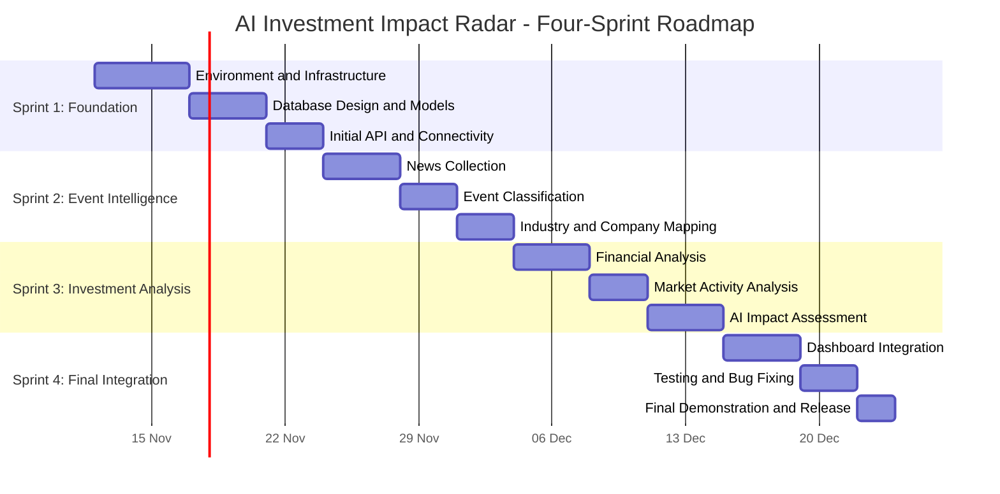

# Four-Sprint Development Plan

**Project Name:** AI Investment Impact Radar

**Tagline:** From Global Events to Investment Insights

**Technology Stack:** Python, Streamlit, FastAPI, PostgreSQL, SQLAlchemy, Pandas, Docker Compose

---

## 1. Plan Overview and Development Strategy

The AI Investment Impact Radar will be developed across four sequential sprints. Each sprint delivers a working increment of the system, progressing from the technical foundation to a complete investment impact analysis platform.

The project focuses on an initial MVP covering Thai publicly listed companies within one or two selected industries.

1. **Sprint 1 – Foundation and Database:** Establish the development environment, backend, frontend, PostgreSQL database, SQLAlchemy models, and initial API endpoints.
2. **Sprint 2 – News and Event Intelligence:** Implement news collection, event classification, information extraction, and mapping events to relevant industries and companies.
3. **Sprint 3 – Investment Analysis Engine:** Implement financial analysis, market activity analysis, and AI-powered investment impact assessments.
4. **Sprint 4 – Dashboard, Integration and Release:** Integrate all modules into the Streamlit dashboard, complete testing, improve reliability, and prepare the final demonstration.

### Development Roadmap

*Note: The roadmap illustrates development order and relative duration, not confirmed calendar deadlines.*

---

## 2. Sprint 1 – Foundation and Database

### 2.1 Sprint Goal

Establish a functional technical foundation for the AI Investment Impact Radar by configuring the development environment, connecting the frontend and backend, setting up PostgreSQL, and designing the initial database structure.

At the end of Sprint 1, the application should have a working Streamlit frontend, FastAPI backend, PostgreSQL connection, and initial database models that support the upcoming development modules.

### 2.2 Features Included

- **FEAT-01:** Development Environment and Infrastructure Setup
- **FEAT-02:** PostgreSQL Database and Data Models
- **FEAT-03:** Backend API Foundation
- **FEAT-04:** Frontend Application Foundation

### 2.3 Main Implementation Tasks

1. **Infrastructure and Environment Setup**
   - Configure Python virtual environment.
   - Establish the project directory structure.
   - Configure Docker Compose for PostgreSQL.
   - Create `.env.example` and configure environment variables.
   - Configure Git repository and `.gitignore`.

2. **Database Design and Models**
   - Design the initial relational database structure.
   - Implement SQLAlchemy models for:
     - News articles
     - Events
     - Industries
     - Companies
     - Financial data
     - Market data
     - Event-company relationships
     - Impact assessments
   - Establish primary keys, foreign keys, and relationships.
   - Verify database connectivity and table creation.

3. **Backend API Foundation**
   - Configure FastAPI application.
   - Implement database session management.
   - Create health-check endpoint.
   - Establish API routing structure.
   - Implement basic database read and write operations.

4. **Frontend Application Foundation**
   - Configure Streamlit application.
   - Establish the main dashboard layout.
   - Create initial navigation structure.
   - Configure communication between Streamlit and FastAPI.

### 2.4 Expected Deliverables

- Functional Python development environment.
- Running PostgreSQL database through Docker Compose.
- Initial SQLAlchemy database models.
- Working FastAPI application and health-check endpoint.
- Working Streamlit application skeleton.
- Verified frontend-backend and backend-database connectivity.

### 2.5 Testing Requirements

- **Database Tests**
  - Verify PostgreSQL connectivity.
  - Verify database table creation.
  - Verify basic data insertion and retrieval.

- **Backend Tests**
  - Verify FastAPI health-check endpoint.
  - Verify API responses.
  - Verify database session functionality.

- **Frontend Tests**
  - Verify Streamlit application startup.
  - Verify dashboard rendering.
  - Verify backend API connectivity.

### 2.6 Dependencies

- Python environment and required packages.
- Docker Desktop.
- PostgreSQL container.
- Streamlit and FastAPI dependencies.
- SQLAlchemy database configuration.

### 2.7 Definition of Done (DoD)

- [ ] Development environment is configured and reproducible.
- [ ] PostgreSQL runs successfully through Docker Compose.
- [ ] Database models are implemented and tables can be created.
- [ ] FastAPI application starts successfully.
- [ ] Streamlit application starts successfully.
- [ ] Backend can connect to PostgreSQL.
- [ ] Initial database and API tests pass.

---

## 3. Sprint 2 – News and Event Intelligence

### 3.1 Sprint Goal

Develop the system's event intelligence capabilities by collecting news articles, extracting important information, identifying relevant events, and mapping those events to affected industries and publicly listed companies.

At the end of Sprint 2, the system should be able to transform collected news into structured event information and identify potentially affected business sectors and companies.

### 3.2 Features Included

- **FEAT-05:** News Collection and Source Management
- **FEAT-06:** Event Classification and Information Extraction
- **FEAT-07:** Industry and Company Impact Mapping

### 3.3 Main Implementation Tasks

1. **News Collection**
   - Identify suitable news sources and data providers.
   - Implement news retrieval through available APIs or permitted sources.
   - Extract article titles, publication dates, source names, summaries, and URLs.
   - Store collected articles in PostgreSQL.
   - Implement duplicate detection to avoid storing repeated articles.

2. **Event Classification and Information Extraction**
   - Use NLP or an LLM API to summarize collected articles.
   - Classify events into categories:
     - Geopolitical events
     - Economic events
     - Environmental events
     - Government policies and regulations
     - Industry-related events
   - Extract relevant countries, locations, organizations, industries, and companies.
   - Convert news articles into structured event records.
   - Preserve original source links for verification.

3. **Industry and Company Impact Mapping**
   - Establish relationships between industries and listed companies.
   - Identify companies potentially exposed to each event.
   - Distinguish direct and indirect business exposure.
   - Identify possible positive, negative, mixed, or uncertain impacts.
   - Store event-company relationships in PostgreSQL.

4. **Data Validation**
   - Validate extracted information before saving it.
   - Handle incomplete or incorrectly classified articles.
   - Prevent unsupported company-event relationships from being treated as verified facts.

### 3.4 Expected Deliverables

- Working news collection module.
- Stored and structured news article records.
- Event classification and extraction functionality.
- Industry and company mapping functionality.
- Event details with original source references.
- Initial event intelligence API endpoints.

### 3.5 Testing Requirements

- **News Collection Tests**
  - Verify news retrieval.
  - Verify article storage.
  - Verify duplicate detection.
  - Verify missing or invalid article data handling.

- **Event Processing Tests**
  - Verify event classification.
  - Verify information extraction.
  - Verify event summarization.
  - Verify source references are retained.

- **Industry Mapping Tests**
  - Verify event-industry relationships.
  - Verify event-company relationships.
  - Verify direct and indirect exposure classification.

### 3.6 Dependencies

- Completed Sprint 1 database and backend foundation.
- Configured news data sources or APIs.
- Initial industry and company reference data.
- Access to an NLP or LLM service where required.

### 3.7 Definition of Done (DoD)

- [ ] News articles can be collected and stored.
- [ ] Duplicate articles are handled.
- [ ] Articles can be processed into structured events.
- [ ] Event categories and extracted information are stored.
- [ ] Events can be mapped to relevant industries and companies.
- [ ] Original news sources remain accessible.
- [ ] News and event processing tests pass.

---

## 4. Sprint 3 – Financial, Market and AI Investment Analysis

### 4.1 Sprint Goal

Develop the investment analysis engine by combining company financial fundamentals, observable market activity, and AI-powered event impact assessments.

At the end of Sprint 3, the system should be able to evaluate company financial conditions, examine market movements, and generate evidence-backed explanations of how identified events could affect selected companies.

### 4.2 Features Included

- **FEAT-08:** Company Financial Health Analysis
- **FEAT-09:** Market Activity and Investor Sentiment Analysis
- **FEAT-10:** AI Investment Impact Assessment

### 4.3 Main Implementation Tasks

1. **Financial Health and Fundamental Analysis**
   - Collect or import available company financial data.
   - Calculate key financial indicators:
     - Revenue growth
     - Net profit margin
     - Operating margin
     - Debt-to-equity ratio
     - Current ratio
     - Free cash flow
     - Return on equity (ROE)
   - Compare financial performance across historical periods.
   - Identify financial strengths and potential vulnerabilities.
   - Store financial metrics for each company.

2. **Market Activity Analysis**
   - Collect or import available stock market data.
   - Retrieve stock prices and trading volume.
   - Analyze foreign and institutional investor net buying or selling where data is available.
   - Calculate and display relevant market indicators.
   - Identify unusual market movements.
   - Distinguish observable market data from AI-generated interpretations.

3. **AI Investment Impact Assessment**
   - Combine event information, company exposure, financial fundamentals, and market activity.
   - Generate an impact classification:
     - Positive
     - Negative
     - Mixed
     - Uncertain
   - Generate an investment risk classification:
     - Low
     - Medium
     - High
   - Identify possible risk factors and financial vulnerabilities.
   - Explain the causal relationship between an event and a company's potential exposure.
   - Include supporting evidence and original source references.
   - Express uncertainty and avoid presenting predictions as confirmed outcomes.

4. **Analysis API Integration**
   - Implement financial analysis endpoints.
   - Implement market activity endpoints.
   - Implement AI impact assessment endpoints.
   - Store generated assessments in PostgreSQL.
   - Ensure assessments can be retrieved for dashboard presentation.

### 4.4 Expected Deliverables

- Company financial analysis module.
- Market activity analysis module.
- AI-powered investment impact assessment.
- Company impact and risk classifications.
- Evidence-backed analysis with source references.
- Stored assessment history.
- Functional financial, market, and impact analysis API endpoints.

### 4.5 Testing Requirements

- **Financial Analysis Tests**
  - Verify financial indicator calculations.
  - Verify historical financial comparisons.
  - Verify handling of missing financial data.

- **Market Analysis Tests**
  - Verify stock price and volume data processing.
  - Verify investor activity data handling.
  - Verify market indicator calculations.

- **AI Assessment Tests**
  - Verify event and company information is passed correctly.
  - Verify impact and risk classifications follow the expected format.
  - Verify supporting evidence is included.
  - Verify uncertainty and missing information are handled appropriately.

### 4.6 Dependencies

- Completed Sprint 1 database foundation.
- Completed Sprint 2 news and event intelligence modules.
- Company financial data sources.
- Stock market data sources.
- LLM API access for AI-generated assessments.

### 4.7 Definition of Done (DoD)

- [ ] Financial indicators can be calculated from available data.
- [ ] Company financial information can be retrieved.
- [ ] Market activity data can be processed.
- [ ] AI assessments combine event, company, financial, and market information.
- [ ] Impact and risk classifications are generated.
- [ ] Assessments include supporting evidence and uncertainty.
- [ ] Financial, market, and AI analysis tests pass.

---

## 5. Sprint 4 – Dashboard Integration, Testing and Final Release

### 5.1 Sprint Goal

Integrate all developed modules into a complete Streamlit dashboard, improve usability, verify end-to-end functionality, resolve defects, and prepare the application for the final hackathon demonstration.

At the end of Sprint 4, users should be able to explore relevant events, identify potentially affected companies, inspect company financial and market information, and understand AI-generated investment impact assessments through one interface.

### 5.2 Features Included

- **FEAT-11:** Interactive Investment Impact Dashboard
- **FEAT-12:** Integrated System Verification and Release Preparation

### 5.3 Main Implementation Tasks

1. **Dashboard Development**
   - Display recent global and local events.
   - Display event categories and summaries.
   - Display affected industries and companies.
   - Build company impact and risk ranking views.
   - Display financial health indicators.
   - Display stock prices and trading activity charts.
   - Display AI-generated investment impact explanations.
   - Provide access to supporting news sources.

2. **Frontend and Backend Integration**
   - Connect Streamlit pages and components to FastAPI endpoints.
   - Integrate news, event, financial, market, and AI analysis modules.
   - Ensure data is retrieved and displayed consistently.
   - Handle loading states, empty results, and API errors.

3. **System Testing and Bug Fixing**
   - Execute unit and integration tests.
   - Test the complete workflow from news collection to dashboard presentation.
   - Verify database relationships and data consistency.
   - Test missing, invalid, and incomplete data scenarios.
   - Fix defects identified during testing.
   - Verify the application can be restarted using documented setup instructions.

4. **Performance and Reliability Improvements**
   - Reduce unnecessary database queries.
   - Improve API response handling.
   - Apply appropriate error handling.
   - Avoid repeated processing of unchanged articles where practical.
   - Ensure the dashboard remains usable with larger result sets.

5. **Final Demonstration Preparation**
   - Prepare representative demonstration data.
   - Prepare an end-to-end demonstration scenario.
   - Finalize project documentation.
   - Verify GitHub repository structure and setup instructions.
   - Prepare the final presentation and demonstration.

### 5.4 Expected Deliverables

- Integrated Streamlit investment dashboard.
- Working connection to all core backend modules.
- Complete event-to-investment-impact workflow.
- Passing test results and defect resolution records.
- Updated project documentation.
- Reproducible local setup instructions.
- Final hackathon demonstration.

### 5.5 Testing Requirements

- **Integration Tests**
  - Verify frontend-backend communication.
  - Verify database operations across modules.
  - Verify event-to-company mapping.
  - Verify financial and market data retrieval.
  - Verify AI assessment retrieval.

- **System Tests**
  - Verify the complete workflow from news collection to impact assessment.
  - Verify dashboard information is consistent with stored records.
  - Verify source links and publication dates are displayed correctly.

- **Usability and Reliability Tests**
  - Verify dashboard navigation.
  - Verify loading and empty states.
  - Verify API and database error handling.
  - Verify the application starts using the documented commands.

### 5.6 Dependencies

- Completed Sprints 1, 2, and 3.
- Integrated backend API endpoints.
- Available demonstration data.
- Working Streamlit frontend and PostgreSQL database.

### 5.7 Definition of Done (DoD)

- [ ] All core modules are integrated.
- [ ] Users can view events and potentially affected companies.
- [ ] Company financial and market information is displayed.
- [ ] AI impact assessments are accessible through the dashboard.
- [ ] Evidence and original news sources are available.
- [ ] Critical integration and system tests pass.
- [ ] No known critical defects remain.
- [ ] Setup instructions are complete and verified.
- [ ] Final demonstration scenario is prepared.

---

## 6. Sprint-to-Feature Summary Matrix

| Sprint | Main Deliverable | Feature IDs | Scope Focus |
|---|---|---|---|
| **Sprint 1** | Technical Foundation | FEAT-01 to FEAT-04 | Environment, database, backend, frontend |
| **Sprint 2** | Event Intelligence Module | FEAT-05 to FEAT-07 | News collection, event classification, industry and company mapping |
| **Sprint 3** | Investment Analysis Engine | FEAT-08 to FEAT-10 | Financial analysis, market activity, AI impact assessment |
| **Sprint 4** | Integrated MVP Release | FEAT-11 to FEAT-12 | Dashboard, system integration, testing, final demonstration |

---

## 7. Overall Project Completion Criteria

The AI Investment Impact Radar MVP is considered complete when:

- [ ] The application can be started using the documented setup instructions.
- [ ] News articles can be collected and converted into structured events.
- [ ] Events can be mapped to relevant industries and listed companies.
- [ ] Company financial indicators can be calculated and displayed.
- [ ] Available market activity data can be retrieved and analyzed.
- [ ] AI can generate explainable investment impact assessments.
- [ ] Users can explore all core information through the Streamlit dashboard.
- [ ] Assessments provide supporting evidence and communicate uncertainty.
- [ ] Core automated tests pass.
- [ ] Final project documentation and demonstration materials are prepared.

**Important Scope Limitation:** The initial release is an MVP, not a production-grade investment platform. Coverage is limited to selected Thai listed companies and industries. Data availability, API access, and AI output quality may limit the depth of analysis. The system provides research support and does not guarantee investment outcomes or provide automatic buy/sell decisions.

---

## 8. Sprint 2 Implementation Status

Sprint 2 (News and Event Intelligence) is complete and verified:

- **FEAT-05 News Article Collection and Storage:** Configurable RSS sources
  (`server/services/news_sources.py`), ingestion pipeline
  (`server/services/news_service.py`), duplicate prevention via unique URL,
  graceful source-failure handling, `GET /api/news`, `GET /api/news/{id}`,
  `POST /api/news/ingest`.
- **FEAT-06 Event Extraction and Classification:** Rule-based baseline classifier
  (`server/services/event_service.py`) with a replaceable `EventClassifier`
  interface; 10 supported categories; classifications tagged with method and
  confidence; linked to source articles; `GET /api/events`,
  `POST /api/events/process`, `GET /api/events/categories`.
- **FEAT-07 Event-to-Industry/Company Mapping:**
  (`server/services/impact_mapping_service.py`) evidence-based mappings with
  impact direction, relevance score, and explanation; uncertain connections
  labelled Uncertain; `GET /api/events/{id}/industries`,
  `GET /api/events/{id}/companies`, `GET /api/companies/{id}/events`.
- **Schema:** Additive, non-destructive migration
  (`server/scripts/migrate_sprint2.py`).
- **Frontend:** Events page in `client/app.py` with articles, events, mappings,
  ingestion/processing buttons, category filtering, and search.
- **Testing:** 36 new Sprint 2 tests; all passing. Total suite: 64 passed, 0
  failed. Development database is never modified (per-test rollback; external
  sources mocked).

Sprint 3+ features (financial analysis, market analysis, AI impact assessment,
advanced dashboard analytics) remain planned and are not implemented.
